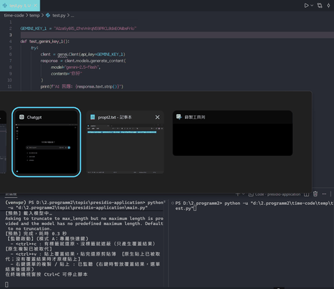
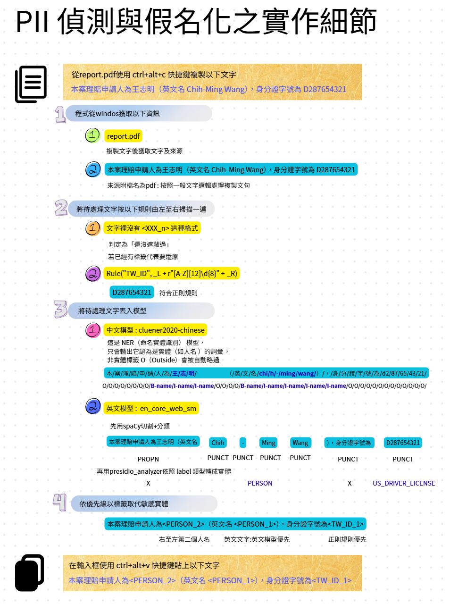
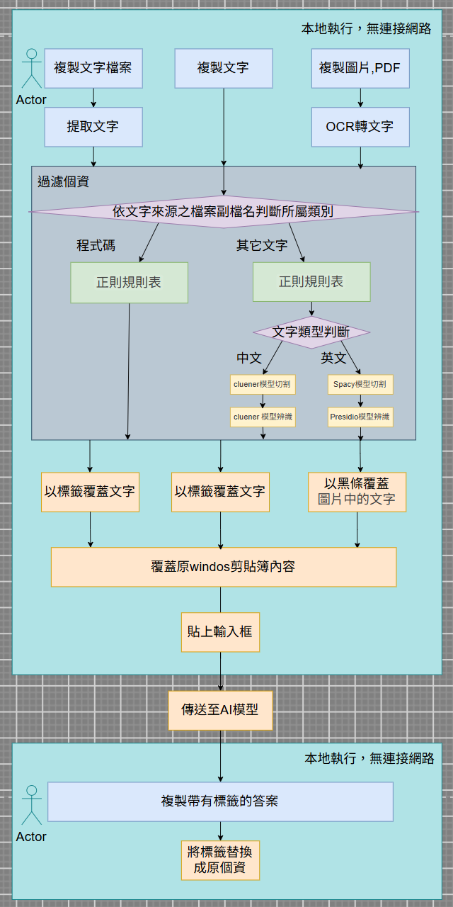

# PII 偵測與假名化系統(剪貼簿敏感資訊防護工具)

複製東西時自動偵測、遮蔽敏感資訊，貼上時可以還原；圖片/PDF/程式碼/一般文字/表格分開處理。
可以用全域快速鍵(命令列版)，也可以開圖形介面手動處理、掃描整個資料夾、管理敏感名單(敏感清單 / 黑名單 / 安全清單)。

## 操作示範






## 檔案結構

```
core.py            共用核心：前處理接入、遮蔽/還原、重疊處理、分派(code/text/media/field/csv)、資料夾掃描、剪貼簿工具、模型預熱
entity_store.py    名單管理(敏感清單 / 黑名單 / 安全清單)、手動新增與自動判斷類型，main.py 與 ui.py 共用
hotkey_service.py  全域快速鍵服務(模式 A/B)與 hotkeys.json 設定檔，main.py 與 ui.py 共用
preprocess.py      送模型前的文字前處理（全形轉半形 / 隱形字元 / 網頁標籤 / 簡繁 / 空白），UI、快速鍵、檔案、圖片 OCR 共用，偵測結果換算回原文座標
main.py            命令列版入口：全域快速鍵 + 名單管理指令(list / add / remove / safe ...)
ui.py              圖形介面(tkinter)：文字 / 檔案 / 資料夾掃描 / 名單管理 / 快速鍵 / 對照表
handler_text.py   一般文字規則（電話、信用卡、Email、URL、檔名、引號密碼...）+ Presidio 模型 + 已知實體清單(known_entities.txt)
handler_code.py   程式碼規則（API Key、JWT、檔案路徑）+ 借用 handler_text 的個資規則
handler_csv.py    表格(csv / tsv / xlsx)：欄位內有個資則整欄遮蔽
handler_media.py  圖片 / PDF：OCR 抓文字位置 → 借用 handler_code 的規則 + Presidio 判斷 → 塗黑 → 存對照表
handler_field.py  （選用）欄位型偵測，存在時 core.py 會自動併入候選
```

所有檔案要放在**同一個資料夾**。`main.py` 與 `ui.py` 互相獨立，彼此不 import，兩者都只呼叫 `core.py` / `entity_store.py` / `hotkey_service.py`：

```bash
python main.py                  # 命令列版：全域快速鍵，執行中也能直接輸入名單管理指令
python ui.py                    # 圖形介面版（可在「快速鍵」分頁啟動同樣的全域快速鍵）
```

## 安裝

```bash
pip install pywin32 psutil pyperclip pynput
pip install presidio-analyzer pillow pymupdf
pip install openpyxl                    # 處理 xlsx 表格用
pip install opencc-python-reimplemented  # 前處理的簡繁統一用
pip install transformers torch          # 中文 NER 用
python -m spacy download en_core_web_sm
```

圖形介面用的 `tkinter` 隨 Python 安裝，不用另外裝（Windows 安裝 Python 時請保留 tcl/tk 選項）。

圖片 / PDF 的文字辨識使用 **Windows 內建 OCR**，不再使用 Tesseract，也不用另外安裝 OCR 主程式。需要在 Windows 的「設定 → 時間與語言 → 語言與區域」
安裝要辨識的語言（繁體中文、英文）並確認有勾選「光學字元辨識」。呼叫 Windows OCR 所需的 Python 套件以 `handler_media.py` 檔頭的 import 為準。

第一次執行時，中文 NER 模型（`ZH_NER_MODEL_NAME`，目前是 `uer/roberta-base-finetuned-cluener2020-chinese`）會自動從 Hugging Face 下載（幾百 MB），需要網路；之後會用本地快取。沒裝 `transformers`、沒網路下載模型、或完全沒裝 Presidio，程式都會自動偵測失敗並退化，只用正則規則。

---

## 整體流程




### 文字前處理（送模型前）

文字、程式碼、表格儲存格、圖片與 PDF 的 OCR 文字，在送進規則與模型偵測**之前**，統一先過 `preprocess.py`（流程參考 text-preprocessing notebook）。UI 文字分頁、全域快速鍵、檔案、資料夾掃描、圖片/PDF 走的是同一套。

**偵測用前處理後的文字，遮蔽卻改回原文。** 前處理會改變字數，所以每個輸出字元都記住它對應原文的區間，偵測結果再換算回原文座標：

- 使用者的原文只有被偵測到的那一段會變，全形、HTML 標籤、空白、簡體字其餘部分原樣保留。
- 對照表存的是原文，還原後與原文逐字相同（含 `\r\n` 與隱形字元）。

在 UI 文字分頁按「預覽前處理」，可以看到每一步改了哪些地方與最後送模型的文字；勾選框可整個關閉（`preprocess.ENABLED`）。

**怎麼確認前處理有沒有讓分數變差？** 測試程式加 `--ablation`：

```bash
python 測試程式_多版本評分_檔案輸入版.py t1.json --ablation
```

同一篇文章依序用「不前處理 / 每個步驟單獨開 / 目前預設 / 舊版全開」各跑一次，列出 P / R / F1，並指出每個設定相對於不前處理**多命中、不再命中、新增誤判**了哪些實體。評分時預設不套用敏感清單 / `known_entities.txt` / 安全清單（`USE_LISTS = False`），否則使用過程中累積的清單會混進分數。單篇答案只有二、三十筆時，一筆之差就是好幾個百分點，建議用多篇文章比較。

### 快速鍵的兩種模式

| 模式                   | 條件                  | 行為                                                                                                                                                         |
| ---------------------- | --------------------- | ------------------------------------------------------------------------------------------------------------------------------------------------------------ |
| A・專屬快速鍵          | `paste` 有設定值    | 複製鍵只算出覆蓋結果並暫存，不動剪貼簿；按貼上鍵才暫時寫入剪貼簿、模擬 Ctrl+V、貼完立刻還原。原生 Ctrl+C / Ctrl+V 不受影響                                   |
| B・Ctrl+C 直接當快速鍵 | `paste` 留空 (null) | 原生 Ctrl+C 寫完剪貼簿後，程式讀出來處理並**直接覆寫剪貼簿**，原生 Ctrl+V 自然貼出處理後版本。處理完成前就貼上會貼出原始內容；終端機按 Ctrl+C 也會觸發 |

### 對照表與清單檔案

| 檔案                     | 內容                                                                | 誰在維護              | 結束時                 |
| ------------------------ | ------------------------------------------------------------------- | --------------------- | ---------------------- |
| `clipboard_map.txt`    | 純文字/程式碼/表格的`標籤 -> 原文`                                | `core.py`           | 刪除                   |
| `media_deid_map.json`  | 圖片/PDF 每個遮蔽區塊的座標與原始畫面截圖 (base64)                  | `handler_media.py`  | 刪除                   |
| `sensitive_items.json` | 敏感清單：值、類型、次數、最近出現、來源、類型判斷方式、自動/手動   | `entity_store.py`   | **保留，不刪除** |
| `blocked_items.json`   | 黑名單：從敏感清單刪除的值（永遠不會再被自動加入）                  | `entity_store.py`   | **保留，不刪除** |
| `safe_items.json`      | 安全清單：確認不是敏感資料的值（偵測到也不遮蔽）                    | `entity_store.py`   | **保留，不刪除** |
| `known_entities.txt`   | 手動維護的已知實體（`LABEL<Tab>值`），由 `handler_text.py` 讀取 | 使用者                | 保留                   |
| `hotkeys.json`         | 快速鍵設定（`copy` / `paste`）                                  | `hotkey_service.py` | 保留                   |

除了 `hotkeys.json`（放在程式旁邊），其餘都在 `presidio/real/` 底下，存的是**明碼敏感資訊**，注意存放位置的權限，不要外流；也不要手動亂改格式。

### 名單怎麼運作

三份名單由 `entity_store.py` 管理，`ui.py` 與 `main.py` 共用同一份；任何一邊改了，另一邊會自動重新載入（UI 每秒檢查一次）。

| 名單     | 作用                                                                                                                                                 |
| -------- | ---------------------------------------------------------------------------------------------------------------------------------------------------- |
| 敏感清單 | 遮蔽時自動記錄 + 手動新增。清單裡的值之後會被當成正則規則（`source="regex"`，優先序最高）自動遮蔽，不需要模型再判斷                                |
| 黑名單   | 從敏感清單刪除的值。之後**永遠不會再被自動加進**敏感清單；模型仍可能在文字裡偵測到並遮蔽它，只是不再被記錄。手動新增同一個值時會自動移出黑名單 |
| 安全清單 | 確認「不是敏感資料」的值（例如公開的公司名稱、範例帳號）。偵測結果剛好等於清單裡的值時直接略過，不遮蔽，也不會被記進敏感清單                         |

1. **自動記錄**：文字 / 程式碼 / 表格 / 圖片 / PDF 每次遮蔽，偵測到的值會記錄進敏感清單；少於 3 個字的值不記（`KNOWN_MIN_LEN`），預熱、測試、表格逐格判斷用的暫時偵測不會記錄。
2. **一鍵刪除**：在 UI「名單管理 → 敏感清單」點最左邊的「✕」就立刻刪除，刪掉的值進黑名單
3. **標為安全**：在敏感清單選取後按「標為安全」，或到「安全清單」分頁直接輸入，值會進安全清單並從敏感清單移除。
4. **手動新增**：UI「新增敏感資料」分頁一行一筆，可只填值，也可寫成 `類型<Tab>值`，也能匯入文字檔；命令列用 `main.py add`。**類型可以不填**，由模型判斷（見上方技術表），判斷結果與判斷方式會顯示在結果表。至少 2 個字。明確新增的值會自動移出黑名單 / 安全清單。
5. **關閉自動遮蔽**：`core.USE_KNOWN_ITEMS = False`（敏感清單仍會記錄，只是不拿來自動遮蔽）。
6. **圖片 / PDF**：OCR 文字送進 `handler_media.detect_matches` 時，`core.py` 會包一層，同樣套用前處理、敏感清單、`known_entities.txt` 與安全清單（偵測結果是 `(start, end, label, score, source)` 的 tuple 時才補清單；格式不同就只做前處理）。

**命令列指令**（一次性用 `python main.py 指令`，快速鍵執行中直接輸入即可，`help` 看說明、`exit` 結束）：

| 指令                          | 說明                                                     |
| ----------------------------- | -------------------------------------------------------- |
| `list [safe\|blocked]`       | 看敏感清單（預設）/ 安全清單 / 黑名單                    |
| `add 值 [值 ...] [-l 類型]` | 新增敏感資料；不指定類型就由模型判斷（值有空格請加引號） |
| `remove 值 [值 ...]`        | 從敏感清單刪除並加入黑名單                               |
| `safe 值 [值 ...]`          | 加入安全清單                                             |
| `unsafe 值 [值 ...]`        | 移出安全清單                                             |
| `unblock 值 [值 ...]`       | 移出黑名單                                               |
| `import 檔案 [-l 類型]`     | 匯入文字檔（每行「值」或「類型<Tab></tab>值」）          |

### 資料夾掃描

在介面的「資料夾掃描」分頁選一個資料夾（可選是否包含子資料夾）→「開始掃描並遮蔽」：

1. 在選擇的資料夾**同層**建立 `<原名>_masked`（已存在就 `_masked_2`、`_masked_3`…），**先把原資料夾裡所有東西複製過去**（含子資料夾、空資料夾、不支援的檔案）。
2. 只處理複製出來的檔案：**檔名不變**，有敏感資訊的檔案內容會被遮蔽，其他檔案原樣保留；原資料夾完全不動。
   - 文字 / 程式碼：保留原編碼（UTF-8 / BOM / Big5）與換行符號。
   - 圖片 / PDF：從原檔讀、寫到複本；沒偵測到內容時複製回原檔，不會留下被重寫過的版本。
   - 表格：欄位內有個資就整欄遮蔽；輸出會變成 UTF-8（含 BOM）。
3. 結果表格依風險排序：**高**（含 API Key、JWT、密碼、信用卡、身分證號等）→ **中**（其他個資）→ 安全。掃描完會跳出對話框列出危險檔案與輸出資料夾位置。
4. 選到 `*_masked` 輸出資料夾會被拒絕；掃描上層資料夾時也會自動略過先前產生的輸出資料夾。`.git`、`node_modules` 等（`SCAN_SKIP_DIRS`）會複製但不掃描。

---

## 客製化教學

以下每一項都只要改對應檔案「設定區」的一小段，不用動偵測/替換的核心邏輯。

### 1. 改快速鍵

**方法 A（建議）**：開 `ui.py` →「快速鍵」分頁 → 按「錄製」後直接按下想用的組合鍵 →「套用並儲存」。服務執行中會立刻用新設定重新綁定。設定存在 `hotkeys.json`，`main.py` 啟動時也會讀同一份。

**方法 B**：直接改 `hotkeys.json`（沒有檔案時用 `hotkey_service.py` 裡的 `DEFAULT_CONFIG`）：

```json
{
  "copy": "<ctrl>+<alt>+c",
  "paste": "<ctrl>+<alt>+v"
}
```

語法照 [pynput 的 HotKey 格式](https://pynput.readthedocs.io/en/latest/keyboard.html#global-hotkeys)：

```json
{ "copy": "<ctrl>+<shift>+m", "paste": "<ctrl>+<alt>+<shift>+v" }
```

想切成模式 B：`"copy": "<ctrl>+c"`，`"paste": null`。

支援的修飾鍵名稱：`<ctrl>`、`<alt>`、`<shift>`、`<cmd>`（Mac）；一般按鍵直接寫小寫字母/數字。

### 2. 新增偵測規則（電話/信用卡/API Key 這類）

一般文字的規則在 `handler_text.py` 的 `RULES`，程式碼專屬規則在 `handler_code.py` 的 `RULES`。格式都一樣：

```python
Rule(name, pattern, flags=0, validator=None)
```

範例：新增台灣護照號碼規則：

```python
# handler_text.py
RULES = [
    ...
    Rule("TW_PASSPORT", r"\b\d{9}\b"),
]
```

範例：新增資料庫連線字串規則（程式碼專用）：

```python
# handler_code.py
RULES = [
    ...
    Rule("DB_CONN_STRING", r"(?:postgres|mysql|mongodb)://[^\s\"']+"),
]
```

不想寫規則、只是有幾個固定要遮的值（某個專案代號、客戶名稱）：直接讓它被遮蔽過一次，就會進敏感清單，之後自動遮蔽。

### 3. 換掉某個語言用的 NLP 模型

`handler_text.py` 裡的 `NLP_MODELS` 是語言對應模型的註冊表：

```python
NLP_MODELS = {
    "en": presidio_en,
    "zh": zh_ner,        # 目前是 Hugging Face 的中文 NER (ZH_NER_MODEL_NAME)，不經過 Presidio / spaCy
}
```

想整個換掉中文那層（例如換別的中文 NER 模型、接雲端 API），步驟固定：

```python
# 1. 寫一個函式，輸入文字、輸出格式一致的比對結果
def my_chinese_model(text: str):
    results = my_model.analyze(text)
    return [(r.start, r.end, r.type) for r in results]

# 2. 蓋掉字典裡的值
NLP_MODELS["zh"] = my_chinese_model
```

改完這一行，`detect()`、`handler_code.py`、`handler_media.py` 完全不用動，因為它們都是呼叫 `presidio_matches()` / `detect()` 這個統一入口。

### 4. 調整「複製檔案 / 掃描資料夾」時的分類規則

`core.py` 設定區：

```python
CODE_EXTENSIONS = {".py", ".js", ".ts", ...}
MEDIA_EXTENSIONS = {".jpg", ".jpeg", ".png", ".pdf", ...}
TEXT_FILE_EXTENSIONS = {".txt", ".md", ".log"}
TABLE_EXTENSIONS = handler_csv.TABLE_EXTENSIONS   # .csv .tsv .xlsx .xlsm，交給 handler_csv
```

複製到的檔案副檔名如果不在這幾個集合裡，會直接跳過不處理。想支援更多類型，把副檔名加進對應集合即可。注意 `.csv` 已經從純文字檔移到表格類。

### 5. 調整表格（csv / xlsx）的欄位規則

`handler_csv.py` 的 `HEADER_RULES`：一行一條 `(表頭 regex, 標籤類型)`，命中的欄位不看內容、整欄遮蔽：

```python
HEADER_RULES = [
    (re.compile(r"姓名|名字|聯絡人", re.I), "PERSON"),
    (re.compile(r"e-?mail|電子郵件|信箱", re.I), "EMAIL_ADDRESS"),
    ...
]
```

其他欄位只要有一格偵測到個資就整欄遮蔽。如果不想因為某些類型（例如日期、網址）就整欄遮蔽：

```python
IGNORE_TYPES_FOR_COLUMN = {"DATE_TIME", "URL"}
```
